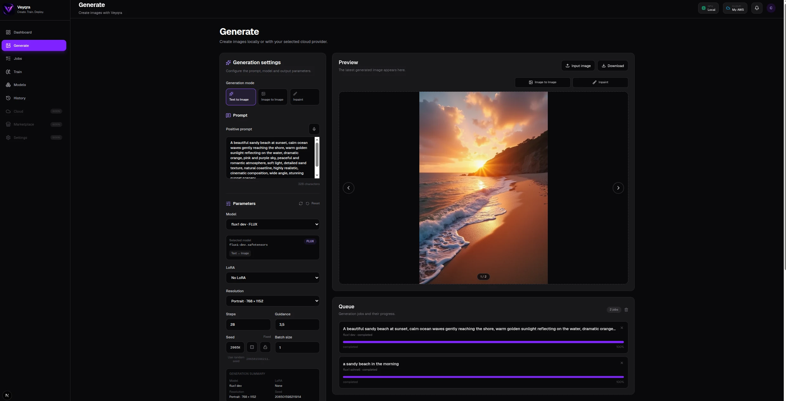
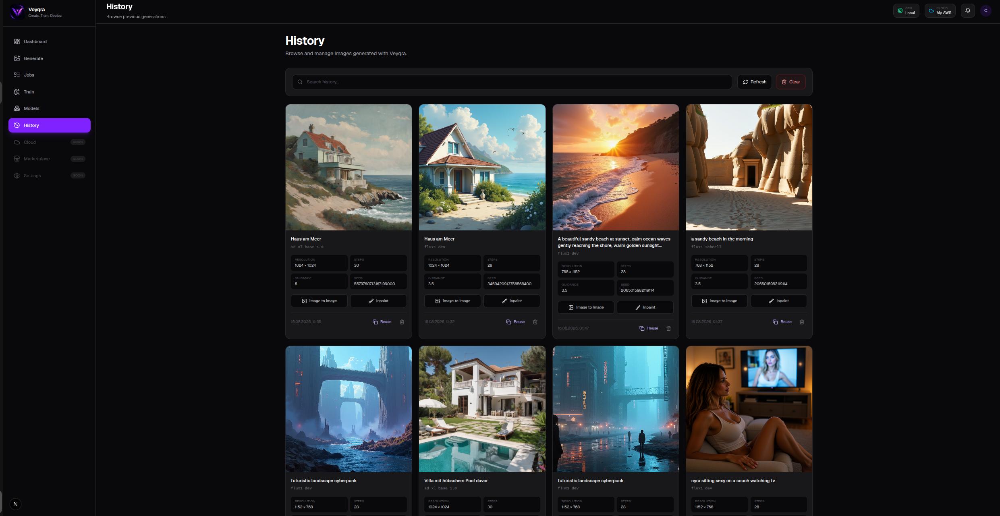
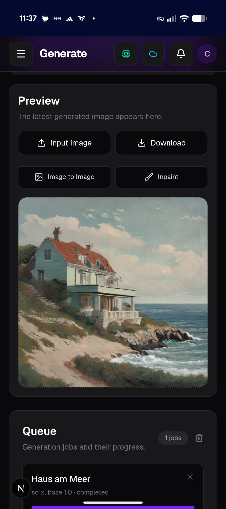

<p align="center">
  
</p>

<h1 align="center">Veyqra</h1>

<p align="center"><strong>Local AI image generation, without the ComfyUI node graphs.</strong></p>

<p align="center">
  <a href="https://github.com/veyqra/veyqra-app/blob/main/LICENSE"></a>
  
  
  
  
</p>

**Veyqra is a free, open-source interface for running FLUX and SDXL image generation on your own computer.** Keep your models and generated images local, reuse your existing ComfyUI setup, and create without building node graphs. No Veyqra account or cloud subscription is required for local generation.

> **Early alpha (v0.1.0):** Local generation works today. Training, managed cloud execution, authentication, and a marketplace are roadmap items, **not current features**. Expect rough edges and help us improve them.



## Why Veyqra?

| | Veyqra today |
| --- | --- |
| **Straightforward UI** | Generate and edit images without manually wiring ComfyUI nodes |
| **Run locally** | Use your own GPU and keep generated images on your machine |
| **Model choice** | FLUX and SDXL workflows, plus compatible LoRAs found in ComfyUI |
| **Useful creative tools** | Text-to-Image, Image-to-Image, and Inpaint |
| **Keep working** | Queue multiple jobs, follow progress, and revisit history |
| **Your existing setup** | Reuse an existing ComfyUI installation or try the guided installers |

### See it in action

| Generate | History |
| --- | --- |
|  |  |

On mobile, Veyqra provides a responsive generation workspace:



## Get started

**Requirements:** Git, Node.js 22+, npm, Python (3.12 recommended on Linux), a suitable GPU and compatible drivers. The installer can reuse or set up ComfyUI. Model weights can require substantial disk space and downloads; see the [full installation reference](#installation) before starting.

### Windows

1. Clone the repository and open a terminal in its root folder.
2. Run the guided installer:
   ```powershell
   scripts\install-windows.cmd
   ```
3. Start ComfyUI and Veyqra:
   ```powershell
   scripts\start-comfyui.cmd
   npm run dev:windows
   ```
4. Visit **http://localhost:3000**.

### Linux

1. Clone the repository and enter the project directory:
   ```bash
   git clone https://github.com/veyqra/veyqra-app.git
   cd veyqra-app
   ```
2. Run the installer:
   ```bash
   scripts/install-linux.sh
   ```
3. Start the app (start ComfyUI if the installer did not already start it):
   ```bash
   npm run dev
   ```
4. Visit **http://localhost:3000**.

Want to inspect the Linux installer before making changes? Run `scripts/install-linux.sh --dry-run --yes`. Existing ComfyUI installations are supported, and large model downloads remain opt-in. Review GPU-specific limitations and manual setup instructions under [Installation](#installation).

## Who is Veyqra for?

- **Artists and creators** who want local image generation with a less technical interface.
- **ComfyUI users** who want a focused everyday workspace for standard tasks.
- **Open-source contributors** interested in local-first creative tools, AMD/NVIDIA compatibility, and accessible AI workflows.

## Help shape the project

Veyqra is community-driven and in early alpha. Try an installation, report bugs with your OS/GPU and reproduction steps, or contribute code and documentation. See [Contributing](CONTRIBUTING.md) and [Security](SECURITY.md). Feature ideas and questions are welcome in [GitHub Discussions](https://github.com/veyqra/veyqra-app/discussions).

**Potential next milestones:** smoother setup, stronger queue/cancellation reliability, LoRA training, and packaging. See the [Roadmap](#roadmap) for planned work. No paid tiers are planned for the initial open-source release.

## Features in detail

- Dashboard with job, model, and runtime status
- FLUX and SDXL Text to Image, Image to Image, and Inpaint modes
- Model and LoRA catalog loaded directly from ComfyUI
- Multiple generation jobs in the ComfyUI queue
- Progress, status, error reporting, and persistent job metadata
- Automatic inpaint segmentation through a grounding-mask workflow
- Optional mask prompt with automatic extraction from the positive prompt
- Local prompt translation from German, French, Spanish, Italian, and Portuguese to English
- Voice input through the browser Speech Recognition API
- Persistent history with reusable images and metadata
- Direct reuse of history and preview images for Image to Image or Inpaint
- Previous/next image navigation in Preview and History
- Live ComfyUI GPU, VRAM, running-job, and pending-job information
- Local notifications for completed, failed, and cancelled jobs
- Responsive desktop and mobile navigation

## Installation

### Requirements

- Git
- Node.js 22 or newer
- npm
- Python 3.12 recommended
- A supported GPU configuration
- ComfyUI — either an existing installation or a Veyqra-managed installation
- FLUX models and the CLIP/VAE files required by the FLUX workflows
- An SDXL checkpoint in ComfyUI's `models/checkpoints` directory for SDXL
  generation

Inpaint additionally requires the custom nodes and models referenced below.

### Required ComfyUI components

Veyqra uses a small set of ComfyUI custom nodes in addition to the standard
ComfyUI installation. The automated Veyqra installers install these
dependencies automatically.

If you use an existing ComfyUI installation or configure Veyqra manually, make
sure the following components are available.

#### Required custom nodes

**ComfyUI-Grounding**

- Repository: https://github.com/PozzettiAndrea/ComfyUI-Grounding
- Provides: `GroundingMaskModelLoader`, `GroundingMaskDetector`
- Purpose: Automatic mask detection in Inpaint workflows
- The current Inpaint workflow uses `Florence-2: Base (Segmentation)` for mask
  detection

The exact custom-node repositories installed by Veyqra are defined in:

```text
config/comfyui-nodes.json
```

#### Optional custom nodes

**ComfyUI-Manager**

- Repository: https://github.com/Comfy-Org/ComfyUI-Manager
- Purpose: Optional ComfyUI node browser and installer
- Installation: Use `--with-manager` on Linux or `-WithManager` on Windows

#### Required model files for FLUX

The current FLUX workflows expect the following model files:

```text
ComfyUI/models/clip/clip_l.safetensors
ComfyUI/models/clip/t5xxl_fp16.safetensors
ComfyUI/models/vae/ae.safetensors
```

FLUX diffusion models can be stored in either:

```text
ComfyUI/models/diffusion_models/
```

or:

```text
ComfyUI/models/unet/
```

LoRAs belong in:

```text
ComfyUI/models/loras/
```

#### Required model files for SDXL

At least one compatible SDXL checkpoint is required in:

```text
ComfyUI/models/checkpoints/
```

For example:

```text
sd_xl_base_1.0.safetensors
```

The Veyqra installers can optionally download the supported official model
bundles and place them in the correct directories automatically.

### Automated Linux installer

The automated installer for Linux is available here:

```bash
scripts/install-linux.sh
```

It performs the following steps:

- Checks Git, Python, Node.js, and npm
- Detects common existing ComfyUI installations and lets interactive users
  reuse one, create a separate Veyqra-managed copy, or enter another path
- Detects an AMD, NVIDIA, or CPU backend
- Clones ComfyUI into a user-owned Veyqra data directory
- Creates isolated Python environments for ComfyUI and the Veyqra API
- Installs the appropriate PyTorch build and ComfyUI dependencies
- Installs the required custom nodes from `config/comfyui-nodes.json`
- Creates all model directories used by the Veyqra workflows
- Optionally downloads selected official FLUX models plus their shared CLIP-L,
  T5XXL and VAE files, or the official SDXL Base 1.0 checkpoint, directly into
  the correct ComfyUI directories
- Writes the local ComfyUI URL to `apps/api/.env`
- Starts ComfyUI and verifies its system, queue, and required-node endpoints

Review the complete plan without changing the system:

```bash
scripts/install-linux.sh --dry-run --yes
```

Interactive runs ask separately for the Veyqra data/install directory and the
ComfyUI directory. The Veyqra application repository itself remains at the
location from which the installer is executed.

Useful options:

```text
--gpu auto|amd|nvidia|cpu
--install-dir PATH
--comfyui-dir PATH
--torch-index-url URL
--hsa-override VERSION
--with-manager
--with-translations
--models flux-schnell,flux-dev,flux-fill,sdxl-base|all|none
--no-start
--update
```

The installer never uses `sudo` and does not install GPU drivers. Large model
downloads remain an explicit user choice. Interactive runs display a model
picker; unattended runs download no models unless `--models` is supplied.
For example:

```bash
HF_TOKEN=hf_your_token scripts/install-linux.sh \
  --models flux-dev,flux-fill
```

The full shared FLUX assets require about 10.4 GB, and each full FLUX diffusion
model adds about 23.8 GB. SDXL Base 1.0 requires about 6.94 GB and does not need
the FLUX shared assets. Downloads resume from `.part` files, check available
disk space, and verify SHA-256 before replacing the destination file. Gated
FLUX files require accepted Hugging Face agreements. Tokens are read from
`HF_TOKEN` or prompted without echo and are never written to Veyqra's
configuration.

Run `scripts/install-linux.sh --help` for all options.
In non-interactive runs, a previously selected installation is reused; otherwise
the installer uses Veyqra's managed data directory.
On Linux-mounted NTFS or exFAT volumes, the installer automatically creates
symlink-free Python environments and installs frontend dependencies without npm
workspace links.

### Automated Windows installer

Run the PowerShell installer from the repository root:

```powershell
scripts\install-windows.cmd
```

Interactive runs ask separately for the Veyqra data/install directory, the
ComfyUI directory, and optional FLUX or SDXL model downloads. The final
installation plan requires an explicit `y` or `n` confirmation.

It checks Git, Python 3.11+, Node.js 22+, and npm; detects or installs ComfyUI;
creates isolated Python environments; installs the required custom nodes; and
configures the Veyqra API. Existing ComfyUI virtual environments and portable
Python installations are reused when possible.

Useful PowerShell options:

```powershell
scripts\install-windows.ps1 `
  -ComfyUIDir "D:\AI\ComfyUI" `
  -Gpu Nvidia `
  -WithManager `
  -WithTranslations
```

Other options include `-InstallDir`, `-Python`, `-TorchIndexUrl`, `-Models`,
`-Update`, `-NoStart`, `-Yes`, and `-DryRun`. Optional FLUX downloads require
`HF_TOKEN` and accepted Hugging Face model agreements:

```powershell
$env:HF_TOKEN = "hf_your_token"
scripts\install-windows.ps1 -Models flux-schnell,sdxl-base
```

NVIDIA and CPU PyTorch packages are selected automatically. Windows AMD builds
are hardware-specific: reuse an already working AMD ComfyUI installation, use
the official AMD portable package, or provide its documented package index via
`-TorchIndexUrl`.

After installation:

```powershell
scripts\start-comfyui.cmd
npm run dev:windows
```

The steps below describe the equivalent manual installation.

### 1. Clone the repository and install Node dependencies

```bash
git clone <repository-url> veyqra
cd veyqra
npm install
```

### 2. Create the API Python environment

```bash
python3.12 -m venv apps/api/.venv
apps/api/.venv/bin/pip install --upgrade pip
apps/api/.venv/bin/pip install -r apps/api/requirements.txt
```

### 3. Configure the API

```bash
cp apps/api/.env.example apps/api/.env
```

Default configuration:

```dotenv
VEYQRA_API_HOST=0.0.0.0
VEYQRA_API_PORT=8000
VEYQRA_CORS_ORIGINS=http://localhost:3000,http://127.0.0.1:3000
VEYQRA_COMFYUI_URL=http://127.0.0.1:8188
VEYQRA_PUBLIC_API_URL=
```

`VEYQRA_PUBLIC_API_URL` is used to create history and mask image URLs. Keep it
empty when the frontend's same-origin API proxy is used. Set an absolute URL
only when clients access the API directly.

### 4. Configure the frontend

Create `apps/web/.env.local` if a custom API address is needed:

```dotenv
NEXT_PUBLIC_VEYQRA_API_URL=/api/v1
VEYQRA_ALLOWED_DEV_ORIGINS=
```

The frontend uses this same-origin path by default and proxies API requests to
the local FastAPI service. This also avoids mixed-content errors when Veyqra is
served over HTTPS.

For development access from other devices, set
`VEYQRA_ALLOWED_DEV_ORIGINS` to a comma-separated list of local hostnames or IP
addresses. Keep machine-specific values in the untracked `.env.local` file.

### 5. Install local translation models

```bash
npm run translation:setup
```

The script downloads local Argos translation models for:

- German → English
- French → English
- Spanish → English
- Italian → English
- Portuguese → English

Models are stored in `apps/api/data/translation-models`. Once installed,
prompt translation does not require an external service.

Specific languages can also be installed separately:

```bash
cd apps/api
.venv/bin/python scripts/install_translation_models.py de fr
```

### Docker Compose

Docker Compose runs the Veyqra web interface and API. ComfyUI, custom nodes,
models, and GPU drivers remain installed on the host and are not copied into
the containers.

ComfyUI must accept connections from Docker. When using the Veyqra-managed
ComfyUI installation on Linux, start it with:

```bash
VEYQRA_COMFYUI_HOST=0.0.0.0 scripts/start-comfyui.sh
```

Then build and start Veyqra:

```bash
docker compose up --build -d
```

Open <http://localhost:3000>. View the logs or stop the services with:

```bash
docker compose logs -f
docker compose down
```

Generated images, uploads, job metadata, history, and installed translation
models remain in `apps/api/data`. The API is exposed only on
`http://127.0.0.1:8000`; browser requests use the frontend's same-origin proxy.

Compose connects to ComfyUI at `http://host.docker.internal:8188` by default.
Override the address, ports, or container user in a root `.env` file when
needed:

```dotenv
VEYQRA_COMFYUI_URL=http://host.docker.internal:8188
VEYQRA_WEB_PORT=3000
VEYQRA_API_PORT=8000
VEYQRA_UID=1000
VEYQRA_GID=1000
```

On Linux, use your numeric `id -u` and `id -g` values if they are not `1000`.
Do not expose ComfyUI's port to untrusted networks.

## Running the development environment

Start ComfyUI first. Then start the API and web app together:

```bash
npm run dev
```

Press `Ctrl+C` to stop both processes.

Workflow JSON templates are cached by the API process. After editing a file in
`apps/api/workflows`, restart the backend completely; Python hot reload alone
does not invalidate the workflow cache.

On Windows, use PowerShell from the project directory:

```powershell
npm run dev:windows
```

The Windows script can also be started directly:

```powershell
scripts\start-dev.cmd
```

Alternatively, run them in separate terminals.

Terminal 1:

```bash
npm run api
```

Terminal 2:

```bash
npm run web
```

The following addresses will be available:

- Web app: <http://localhost:3000>
- API: <http://localhost:8000>
- OpenAPI documentation: <http://localhost:8000/docs>
- Health check: <http://localhost:8000/api/v1/health>

The root page redirects to `/dashboard`.

## Supported model families

Veyqra currently supports FLUX and SDXL. The backend selects the correct
ComfyUI workflow automatically from the generation mode and the selected
model's detected family. The frontend does not infer the family with its own
filename checks.

### FLUX

FLUX uses the existing guidance-based controls and dedicated workflow
templates for Text to Image, Image to Image, and FLUX Fill inpainting. FLUX
LoRAs are applied to the model path.

### SDXL

SDXL has dedicated workflow templates for Text to Image, Image to Image, and
Inpaint. The UI exposes SDXL-specific defaults and controls:

- 30 steps and CFG `6.0`
- `dpmpp_2m` sampler with the `karras` scheduler
- Positive and negative prompts
- Seed, batch size, sampler, and scheduler
- Optional SDXL LoRAs applied to both the model and CLIP paths

For SDXL Text to Image, the available resolutions are:

- `1024 × 1024`
- `832 × 1216`
- `1216 × 832`
- `896 × 1152`
- `1152 × 896`

The model catalog recognizes common SDXL checkpoint names such as `sdxl`,
`sd_xl`, Juggernaut XL, RealVis XL, and DreamShaper XL. Compatible FLUX and
SDXL LoRAs are grouped by model family. LoRAs whose family cannot be detected
remain available as unclassified adapters.

## Generation modes

### Text to Image

Creates a new image from a prompt. It supports model and LoRA selection,
resolution, seed, steps, guidance or CFG, sampler, scheduler, and batch size.
Text-to-image workflows always use full denoising (`1.0`).

### Image to Image

Uses an uploaded image or an image selected from history. The original input
resolution is preserved, and denoise controls the transformation strength.

### Inpaint

Also preserves the original input resolution. FLUX Fill and SDXL always use a
denoise value of `1.0` for inpainting.

The mask area can be entered explicitly, for example:

```text
red shirt
```

When the mask field is empty, Veyqra extracts the target from an instruction
such as:

```text
Replace the red shirt with a black jacket.
```

Non-English input is translated locally. The extracted target is sent to the
grounding detector as the mask prompt and removed from the final generation
prompt. The detected mask is saved as a dedicated ComfyUI output and displayed
in the Preview panel.

<!-- SCREENSHOT: Inpaint workflow
Suggested file: docs/screenshots/inpaint-mask-result.webp
Replace this marker with:

Show a neutral input image, the detected mask, and the final result.
-->

## Queue and jobs

The Generate button becomes available again as soon as ComfyUI accepts a job.
This allows multiple workflows to be queued. Each job is monitored
independently and remains `queued` until the sampler actually starts.

Job metadata is stored in `apps/api/data/jobs.json`. On API startup, Veyqra
attempts to resume monitoring unfinished jobs. The Jobs page displays each
job's prompt, model, status, progress, errors, and result.

## History and local data

Completed images are copied from ComfyUI into Veyqra-owned local storage.

```text
apps/api/data/
├── history.json
├── jobs.json
├── history-images/
├── uploads/
├── translation-models/
└── translation-runtime/
```

History images can be deleted, downloaded, browsed with arrow controls, and
used directly as Image to Image or Inpaint input. Reusing a history image only
prepares the image; it does not overwrite the prompt currently entered in the
editor.


## System status and notifications

Local runtime information comes directly from ComfyUI:

- `/system_stats` provides device, GPU name, and VRAM information
- `/queue` provides running and pending workflows

The API normalizes these responses before returning them to the frontend.
Internal device types such as `cuda` are not used as product labels; the UI
only displays the GPU name and `Local compute`.

The notification bell observes job status transitions through dashboard
polling. The first response establishes a baseline, so existing jobs do not
produce old notifications. Notifications are persisted in browser storage
under `veyqra-notifications`.

<!-- SCREENSHOT: Local system status popover (optional)
Suggested file: docs/screenshots/system-status.webp
Replace this marker with:

Show the GPU name, VRAM usage, and ComfyUI running/pending counters.
-->

## Architecture

```text
Browser
  │
  ▼
Next.js 16 / React 19 / Zustand
  │  REST
  ▼
FastAPI / Pydantic
  │  HTTP + WebSocket
  ▼
ComfyUI
  ├─ Models and LoRAs
  ├─ Workflow queue
  ├─ Progress events
  ├─ Generated images
  └─ GPU, VRAM, and queue status
```

The frontend does not need to know the internal ComfyUI workflow structure.
The API validates each request, loads a workflow template, applies the selected
model, LoRA, prompt, and parameters, and submits the result to ComfyUI.

## Repository structure

```text
veyqra/
├── apps/
│   ├── api/
│   │   ├── app/
│   │   │   ├── api/routes/       # REST endpoints
│   │   │   ├── core/             # Configuration
│   │   │   ├── schemas/          # Pydantic schemas
│   │   │   └── services/         # ComfyUI, jobs, history, models
│   │   ├── scripts/              # Translation model setup
│   │   └── workflows/            # ComfyUI API workflows
│   └── web/
│       └── src/
│           ├── app/              # Next.js routes
│           ├── components/       # UI and workspaces
│           ├── services/         # API clients
│           ├── stores/           # Zustand stores
│           └── types/            # Frontend types
├── docs/                          # Vision and architecture drafts
├── docker-compose.yml             # Web and API containers
└── package.json                   # Workspace scripts
```

## Main API endpoints

All application endpoints use `/api/v1` as their default prefix.

| Method | Endpoint | Purpose |
| --- | --- | --- |
| `GET` | `/health` | Check API health |
| `GET` | `/comfyui/status` | Check the ComfyUI connection |
| `GET` | `/dashboard` | Get statistics, jobs, GPU, VRAM, and queue data |
| `POST` | `/generations` | Create and queue a generation |
| `GET` | `/generations` | List generation jobs |
| `GET` | `/generations/{id}` | Get a job's current state |
| `DELETE` | `/generations/{id}` | Cancel a job in Veyqra |
| `DELETE` | `/generations` | Clear the job list |
| `GET` | `/models/catalog` | Get models and LoRAs from ComfyUI |
| `GET` | `/history` | List history items |
| `DELETE` | `/history/{id}` | Delete a history item |
| `DELETE` | `/history` | Clear history |
| `POST` | `/uploads/image` | Upload an input image |
| `POST` | `/uploads/image/from-history/{id}` | Prepare a history image |

The complete and current OpenAPI specification is available at `/docs` while
the API is running.

## Quality checks

Check frontend types:

```bash
npx tsc --noEmit -p apps/web/tsconfig.json
```

Lint the frontend:

```bash
npm run lint --workspace=web
```

Create a production build:

```bash
npm run build --workspace=web
```

Compile the Python modules:

```bash
cd apps/api
.venv/bin/python -m compileall -q app
```

The root `npm run lint` and `npm run build` scripts are currently placeholders.
Use the workspace commands above for real checks.

## Roadmap

Planned major work packages:

1. Real AWS account integration and cloud instance status
2. Robust queue and cancellation management directly through ComfyUI
3. Training and LoRA workflows
4. Settings, user accounts, and authentication
5. Veyqra Cloud
6. Marketplace and plugin interfaces
7. Production-ready packaging and deployment

The AWS control in the top bar is intentionally shown as disconnected until a real backend connection is available.

## Contributing

See [CONTRIBUTING.md](CONTRIBUTING.md) and
[CODE_OF_CONDUCT.md](CODE_OF_CONDUCT.md).

## Security

Please report security issues according to [SECURITY.md](SECURITY.md).

## License

Veyqra is licensed under the
[GNU Affero General Public License v3.0](LICENSE).

### Third-party components

Veyqra does not distribute AI model weights. Models, LoRAs,
ComfyUI custom nodes, and other third-party components remain subject
to their respective licenses. Users are responsible for reviewing
those licenses before use. Direct dependency license information is
listed in [THIRD_PARTY_NOTICES.md](THIRD_PARTY_NOTICES.md).
